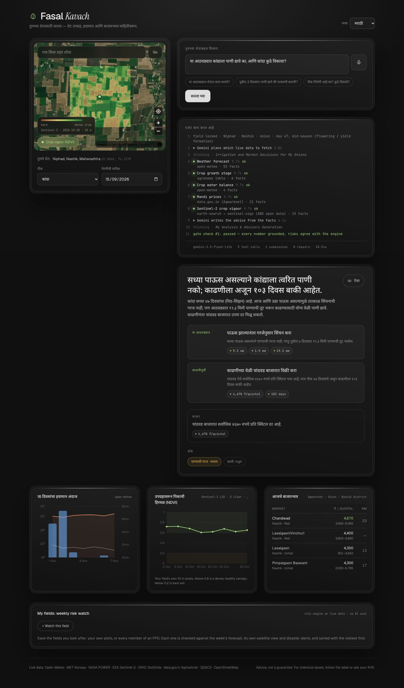
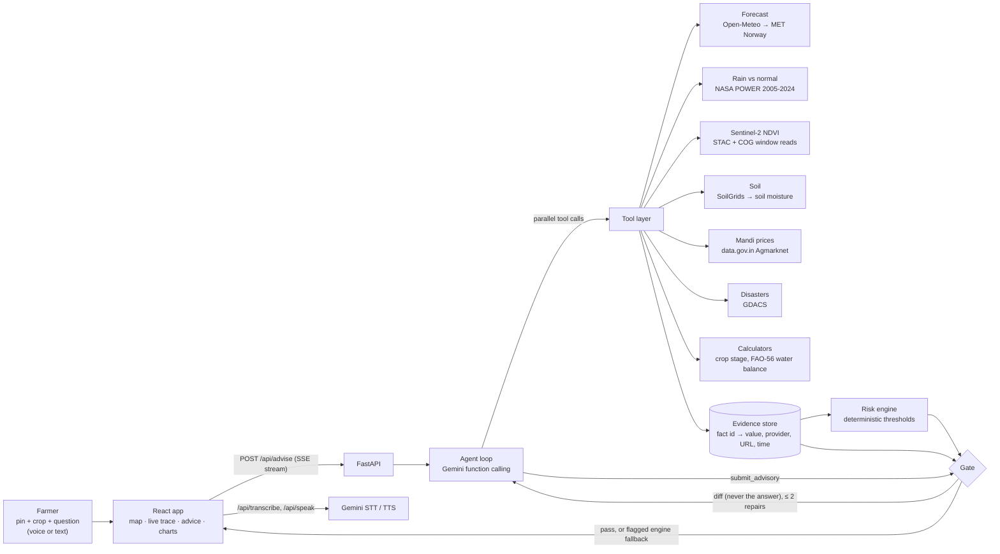

# Fasal Kavach

**A field-level climate-risk agent for Indian farmers.** Drop a pin on a field, name the crop, and
ask in Marathi, Hindi or seven other languages, by voice or text. An AI agent decides which live
data it needs (weather, satellite crop vigour, rainfall vs normal, soil, mandi prices, disaster
alerts) and writes advice for *that* field. Before the farmer sees it, a gate checks every number
against the raw data and every risk against a deterministic agronomy engine. When the gate finds a
problem, the model fixes it on screen.

Forge Gen AI Buildathon, **Theme 2: Climate, Resource Infrastructure & Global Supply Resilience**
(problems 1 and 2 merged: multilingual agri advisory + micro-location climate risk engine).



- **Live app:** https://fasal-kavach.onrender.com (free tier: the first load after idle takes about 50 s)
- **Demo video:** _added at submission_
- **Deck:** https://gamma.app/docs/5ea2xftoiysvl5r

---

## The problem

86% of India's 146 million farm holdings are under 2 ha (Agriculture Census 2015-16). Each week
those farmers decide whether to irrigate, spray, delay fertiliser, harvest or sell, using
**district-level** forecasts that may be 50 km off, mandi prices heard second-hand, and **no view
of their own crop's health**.

The data to do better is public and updated daily: 10 m Sentinel-2 imagery every 5 days, point
forecasts, 20-year rainfall normals and Agmarknet's daily prices. It's spread over portals no
farmer opens, in English, and none of it says what to *do*.

**Who it's for:** small and marginal farmers (voice-first, in their language), plus the Krishi
Sakhis, FPO staff and extension workers who advise them.

## What it does

| | |
|---|---|
| **Field-level** | Weather for the exact coordinates and NDVI from the field's *own* 10 m pixels, with clouds masked using Sentinel-2's scene classification layer |
| **Agentic** | Gemini picks the tools each question needs (a selling question pulls mandi prices; a spraying question pulls wind, rain and humidity) and calls them in parallel |
| **Traceable** | Every number in the advice is a chip you can click to see the raw value, the provider, the request URL and when it was fetched |
| **Self-correcting** | A gate rejects invented numbers, unknown citations, hidden risks, undisclosed data gaps, chemical doses and the wrong language, then sends the model a diff to fix. Two repairs at most, then the engine's own advisory ships, clearly labelled |
| **Honest under failure** | Providers fail over (Open-Meteo → MET Norway; SoilGrids → Open-Meteo soil moisture → NASA POWER). Missing sources are listed and confidence drops. If the LLM itself is down, the engine still answers from the same live data |
| **See the field** | A one-tap NDVI map of the ~1 km around the pin from the latest clear Sentinel-2 pass: 10 m pixels, clouds removed, laid over the satellite basemap |
| **Watch many fields** | Save several plots (a family's, or an FPO's members). The rule engine checks each against live data with no AI cost and lists the riskiest first |
| **Voice** | Speak the question (Gemini transcription) and hear the answer (Gemini TTS, falling back to browser speech) |
| **Actionable** | e.g. "Irrigate about 19 mm over the next 7 days in 2-3 turns", or "Sell stored onion at Chandwad (₹4,670/q, 23 km) rather than Lasalgaon (₹4,300/q)" |

## Architecture



**Why a gate?** The model is good at choosing data and explaining it in plain Marathi, but bad at
arithmetic and prone to filling gaps. So the model writes and code checks. The engine never
shows the model its conclusions, so the check stays independent. The model only gets told what's
wrong, e.g. `'45' matches no fact (nearest fact wx.rain.2026-11-03 = 38.2)`.

The gate's seven checks: schema; citations exist; **number grounding** (every number, including
Devanagari and other Indic digits, must match a fact within tolerance; dates and day counts are
stripped first); **risk agreement** (every moderate or high engine risk must be stated, within one
level); **data-gap disclosure**; **safety** (no pesticide or fertiliser doses); **language
script**.

Details: [docs/ARCHITECTURE.md](docs/ARCHITECTURE.md) · [docs/AGENT.md](docs/AGENT.md) ·
[docs/DATA_SOURCES.md](docs/DATA_SOURCES.md) · [docs/PRD.md](docs/PRD.md)

## Live data sources (all real-time, no mock data)

| Source | What we use |
|---|---|
| Open-Meteo / MET Norway | 16-day point forecast, FAO ET0 (Hargreaves ET0 computed on fallback) |
| NASA POWER | Observed rain to date and the 2005-2024 normal for the same window → IMD category |
| ESA Sentinel-2 L2A (Element84 Earth Search, AWS open data) | 5×5-pixel window of B04/B08/SCL read straight from cloud-optimised GeoTIFFs → NDVI series |
| ISRIC SoilGrids, Open-Meteo, NASA POWER | Soil pH, texture, organic carbon, current moisture |
| data.gov.in (Agmarknet) | Today's modal / min / max price per market, widening from district to state |
| GDACS | Active flood, cyclone, drought, earthquake and wildfire alerts by distance |
| OpenStreetMap Nominatim | Village search, reverse geocoding, market distances |

Agronomy constants (stage lengths, crop coefficients, heat thresholds) are published reference
values, cited in [`backend/app/agronomy.py`](backend/app/agronomy.py): FAO-56, IMD and Hatfield &
Prueger 2015.

## Tech stack

- **Backend:** Python 3.12, FastAPI, httpx, google-genai (Gemini function calling), rasterio +
  numpy + Pillow (COG reads, NDVI rendering), SQLite TTL cache, pytest (43 offline tests,
  including a scripted fake model and a guard that fails if the app imports fixtures or ships
  data files), GitHub Actions CI
- **Frontend:** React 19, TypeScript, Vite, Tailwind CSS 4, MapLibre GL (Esri imagery), Recharts
- **Models:** `gemini-3.8-flash` (agent), `gemini-3.5-transcribe` (speech in), `gemini-3.8-flash-tts`
  (speech out); `gemini-3.5-flash-lite` for development
- **Deploy:** one Docker container (FastAPI serves the built React app) on Render ([`render.yaml`](render.yaml))

## Run it

```bash
git clone https://github.com/shubhambhattog/fasal-kavach && cd fasal-kavach
cp .env.example .env            # add GEMINI_API_KEY (free at aistudio.google.com/apikey)

# backend
cd backend && uv sync && uv run uvicorn app.main:app --port 8000

# frontend (dev, proxies /api to :8000), in a second terminal
cd frontend && pnpm install && pnpm dev       # http://localhost:5173

# or the production build, served by the backend at http://localhost:8000
cd frontend && pnpm build

# tests (no network, no API key needed)
cd backend && uv run pytest -q

# Docker
docker build -t fasal-kavach . && docker run -p 7860:7860 --env-file .env fasal-kavach
```

Optional: `DATA_GOV_API_KEY` (a personal data.gov.in key; the public sample key caps pages at 10
records, which the app pages through) and `AGENT_MODEL` to change the model.

## Evaluation

12 real farm locations in 10 states and 8 languages, plus one prompt injection, all on live data
([docs/EVAL.md](docs/EVAL.md)):

| Run | Change | First pass | Fixed by the model after the gate's diff | Engine fallback |
|---|---|---|---|---|
| v1 | Baseline | 4/12 | 8/12 | 0 |
| v2 | Published IMD / FAO-56 thresholds in tool notes (the engine's verdicts stay private) | 7/12 | 5/12 | 0 |
| v3 | Engine bug the gate exposed (water need before harvest) + Indic dates in the gate | **10/12** | 2/12 | 0 |

Every advisory shipped grounded: when the model failed, the gate caught it and the model fixed it.
This measures the agent's behaviour, not agronomic accuracy; there's no ground truth for that, and
we don't claim one.

## What failed first

| Tried | Result | Fix |
|---|---|---|
| Open-Meteo as the only forecast source | HTTP 429, daily per-IP limit, on day 0 | MET Norway fallback, with Hargreaves ET0 computed for it |
| SoilGrids as the only soil source | HTTP 503 for most of the build | 6 s timeout, then fall back to soil moisture and disclose it |
| Applying the STAC asset's −0.1 reflectance offset | NDVI of 1.4-3.2 (impossible) | Earth Search has already removed ESA's offset (`earthsearch:boa_offset_applied`); apply it only when that flag is false. NDVI is now 0.60-0.72 |
| Treating every day-of-month in the evidence as a "grounded" number | An invented "30 °C" passed because 30 Oct was a date | Strip dates and day counts (English, Hindi and Marathi months) before checking; auto-allow only integers ≤ 3 |
| Mandi markets returned with `id: mandi.lasalgaon` | The model cited it as a fact; the gate rejected it | Return explicit `price_id` / `distance_id` per market |
| MapLibre in a Tailwind 4 layout | Map rendered at 0 px height | MapLibre's unlayered CSS overrides Tailwind's layered `absolute`; positioned the container inline |

More in [docs/DECISIONS.md](docs/DECISIONS.md).

## Limits (honest)

- Advice is decision support, not a guarantee. The gate checks grounding and consistency, not
  agronomic truth.
- NDVI reads a 50 m window around the pin. A mis-placed pin reads the neighbour's field.
- Mandi prices are today's arrivals only; there's no price forecast.
- Crop thresholds are generic per crop, not per variety.

## Roadmap

WhatsApp and IVR channel · proactive alerts for watched fields · KVK expert escalation · PMFBY crop
insurance evidence packs built from the NDVI history · IMD block-level nowcasts · an on-device
model for offline villages.

---

Built by Shubham Bhatt (NIT Delhi), solo, during the Forge buildathon window (2026-10-31 to 2026-11-01).
MIT licence.
