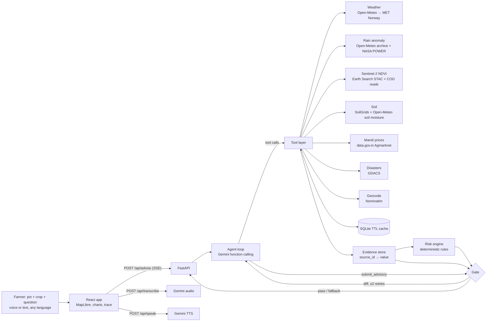
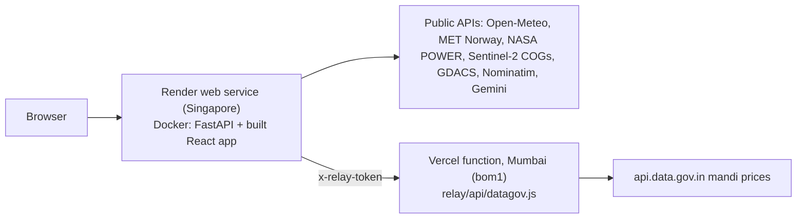

# Architecture

## One-picture view

## Request lifecycle (`POST /api/advise`)

1. **Validate the profile.** Check lat/lon are inside India's bounding box and on land (reverse
   geocode), the crop is in the crop table (or "other"), the sowing date isn't in the future, and
   the language is supported. Bad input returns a structured 422 that the UI explains.
2. **Open an SSE stream.** Each step emits an event: `plan`, `tool_start`, `tool_end`
   (latency, source_ids, status), `engine`, `gate` (pass/fail + diff), `advisory`, `done` or
   `error`.
3. **Run the agent loop** (`agent.py`). Gemini gets the system prompt, the profile and the question,
   plus tool declarations. It calls tools (in parallel where the SDK returns several), sees compact
   results, and finally calls `submit_advisory`.
4. **Fill the evidence store.** Every tool result registers its facts under stable `source_id`s
   such as `wx.tmax.2026-11-03`, `ndvi.2026-10-25` or `mandi.lasalgaon.onion.modal`, each with a
   value, unit, provider, URL and fetch time.
5. **Run the risk engine** (`engine.py`). It runs on whatever evidence exists, never sees the model
   output, and produces `signals[]` (type, level, numbers, evidence ids, threshold source).
6. **Run the gate** (`gate.py`) on the submitted advisory. If it fails, the model gets a diff (not
   the engine's answer) and resubmits. After 2 failures, the engine's templated advisory ships with
   `fallback=true`.
7. **Speak (optional).** The UI asks `/api/speak` for audio of the summary in the chosen language.

## Modules (backend, `backend/app/`)

| Module | Responsibility |
|---|---|
| `main.py` | FastAPI app, routes, SSE, static frontend serving |
| `config.py` | Env-driven settings (models, timeouts, budgets, cache TTLs) |
| `http.py` | Shared httpx client: timeouts, retries off, per-provider circuit breaker, cache wrapper |
| `cache.py` | SQLite TTL cache keyed by `sha256(provider + url + params)` |
| `evidence.py` | `Evidence` dataclass and per-request store; formats compact tool outputs |
| `sources/weather.py` | Open-Meteo forecast → MET Norway fallback; normalised daily series |
| `sources/climate.py` | Season rainfall to date (Open-Meteo archive) vs NASA POWER 20-year climatology |
| `sources/satellite.py` | STAC search → per-scene COG window read (B04, B08, SCL) → NDVI series |
| `sources/soil.py` | SoilGrids (pH, clay, sand, SOC) + Open-Meteo soil moisture |
| `sources/mandi.py` | data.gov.in daily prices: district → state widening; market ranking |
| `sources/disasters.py` | GDACS events within a radius |
| `sources/geo.py` | Nominatim search and reverse geocode, India land check |
| `agronomy.py` | Crop table (stage lengths, Kc, heat thresholds) with citations; growth stage from sowing date |
| `engine.py` | Deterministic risk signals from evidence |
| `tools.py` | Tool declarations (JSON schema) and dispatch to sources |
| `agent.py` | Gemini loop, budgets, retries, SSE events |
| `gate.py` | Advisory validation and diff |
| `voice.py` | Transcription and TTS through Gemini |
| `prompts/*.md` | Versioned system and repair prompts |

## Frontend (`frontend/`)

Built with Vite, React, TypeScript, Tailwind and shadcn/ui. MapLibre GL shows Esri World Imagery
plus an OSM labels layer. Recharts draws the charts.
Panels are Field (map and profile), Ask (text, mic and language), Agent trace (live), Advisory
(actions, risk chips, sources), and Data (forecast, NDVI, mandi).
The production build is served by FastAPI from `/`, so there's **one container and one URL**.

## Reliability design

- **Timeouts:** 8 s per HTTP call (20 s for COG reads), 60 s per LLM call, 90 s per request overall.
- **Fallback chains** inside each tool. Tool results always report `status: ok | partial | unavailable`
  and `providers_tried`.
- **Circuit breaker:** after 3 consecutive failures a provider is skipped for 5 minutes.
- **Cache TTLs:** forecast 1 h, mandi 3 h, NDVI 12 h, soil 30 days, climatology 30 days, geocode 30 days.
  A cache hit is still real data; the UI shows "fetched 14 min ago".
- **LLM failure:** the engine-only advisory (templated, in English with a Gemini translation if one
  is available) ships with `fallback=true` and a visible banner. The demo never dead-ends.
- **Untrusted input:** the user's question and all API text are wrapped as data. Injection
  attempts can't change thresholds, tools or the gate.

## Deployment

One `Dockerfile` (a multi-stage build: node builds the frontend, python:3.12-slim with libexpat1
runs uvicorn) on **Render's free plan** ([`render.yaml`](../render.yaml)), auto-deployed from
`main`. Hugging Face Docker Spaces were the first choice but now need a paid plan.

**data.gov.in refuses connections from foreign datacenters** ("All connection attempts failed" from
Render Singapore, while it works from India). So the mandi source calls a ~30-line relay pinned to
Vercel's Mumbai region (`relay/`). It forwards only the allow-listed mandi dataset, requires a
shared secret, and the advisory still cites the official data.gov.in URL. Without the relay env
vars set (e.g. running locally in India), the app calls data.gov.in directly.

Secrets are Render env vars: `GEMINI_API_KEY`, `DATA_GOV_RELAY_URL`, `DATA_GOV_RELAY_TOKEN`.
